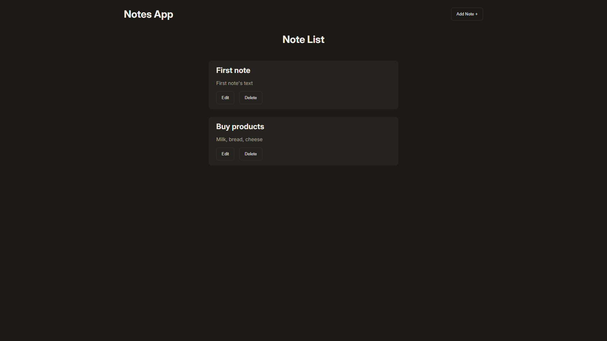

# Notes App

A full-stack CRUD notes application built to practice backend fundamentals: a **React + TypeScript** frontend talking to an **Express** REST API.



## Features

- Create, read, update and delete notes
- Inline add and edit forms (no modals)
- Request validation on the server with [Zod](https://zod.dev)
- Dark theme UI with a warm charcoal/amber palette

## Tech stack

| Part                 | Technologies                              |
| -------------------- | ----------------------------------------- |
| Frontend (`client/`) | React, TypeScript, Vite                   |
| Backend (`server/`)  | Node.js, Express 5, TypeScript, Zod, CORS |
| Tooling              | pnpm, tsx (dev runner), ESLint            |

## Project structure

```
notes-app/
├── client/        # Vite + React + TypeScript frontend
│   └── src/
└── server/        # Express + TypeScript API
    └── src/
        ├── routes/
        ├── db.ts
        └── index.ts
```

## Getting started

### Prerequisites

- Node.js (LTS)
- [pnpm](https://pnpm.io)

### Install

```bash
git clone https://github.com/Atsui04/notes-app.git
cd notes-app

cd server && pnpm install
cd ../client && pnpm install
```

### Run

Start the API and the frontend in two separate terminals:

```bash
# Terminal 1 — API
cd server
pnpm dev

# Terminal 2 — frontend
cd client
pnpm dev
```

- Frontend: Vite dev server, by default `http://localhost:5173`
- API: `http://localhost:3000`

## API

Base path: `/api/notes`

| Method | Endpoint         | Description       |
| ------ | ---------------- | ----------------- |
| GET    | `/api/notes`     | List all notes    |
| GET    | `/api/notes/:id` | Get a single note |
| POST   | `/api/notes`     | Create a note     |
| PUT    | `/api/notes/:id` | Update a note     |
| DELETE | `/api/notes/:id` | Delete a note     |

Request bodies are validated with Zod; invalid input is rejected with an error response.

## Current limitations and roadmap

- Notes are currently stored in an in-memory array on the server, so data resets when the server restarts
- Planned: persistent storage with [lowdb](https://github.com/typicode/lowdb) (JSON file)
- Authentication is intentionally out of scope for this project, the focus is CRUD and backend basics

## What I learned

- Designing and building a REST API with Express and TypeScript
- Validating input with Zod
- Connecting a React frontend to a backend API
- Structuring a client/server project in one repository

## Author

Markiian Bushko — [GitHub](https://github.com/Atsui04)
